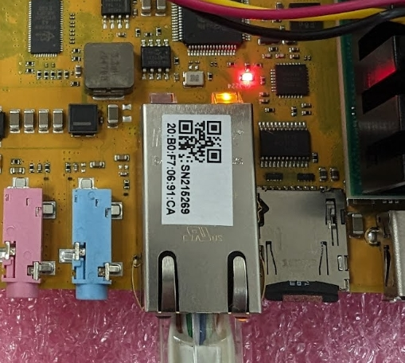

# First boot
[TOC]

## MAC Address / Serial Number

Each MP board should have the unique FPGA module serial number and MAC address
(also encoded as a QR code) on a sticker on the ethernet port:



## Connect to Chameleon's EC and AP consoles

Chameleon's AP and EC consoles are available to user by connecting to the
Chameleon's USB-C port. This port is **not** powered on by the host VBUS, so the
Chameleon won't be detected until the power is turned on.

When Chameleon board is connected to host by USB-C
(USB-C -> USB-C or USB-C -> USB-A) cable and powered on, it will create some
device nodes. The EC and AP consoles are available as /dev/ttyUSB[0-9]+
and the SD card reader as /dev/sd[a-z]. By default, the SD card is connected
to the FPGA, so even if the device exists on the host, it will **not** be able
to access the card until the muxes are set properly.

## Prepare the SD Card

1. Download the latest SD card image (`.img.tar.zst`) from the
[cloud bucket img/ folder](https://console.cloud.google.com/storage/browser/chromeos-hardware-tools-chameleon-v3/img);
select `270_2`, `270_3` or `480_2`, depending on
which FPGA module you have ([see above](#how-to-tell-what-fpga-module-you-have))

2. Untar the file with `tar xf`

3. Insert the microSD card into your computer

    a) Take note of the device name: `/dev/sda` or `/dev/mmcblk0` or something
    else (use `lsblk` to figure out which one)

4. Write the image to the card

    ```bash
    sudo dd if=chameleon_270_2.img of=/dev/mmcblk0 bs=1M status=progress oflag=direct conv=fsync
    ```

5. Eject the microSD card

## Using Chameleon v3 as an SD card adapter

If your computer does not have an SD card adapter, you can use the the
Chameleon v3 as an SD card adapter:

1. Power on the Chameleon board
2. Start a serial terminal for the EC console, e.g.
`pyserial-miniterm /dev/ttyUSB0 115200 --raw`
3. Turn off fpga with `fpga off`
4. Disconnect the SD card from the FPGA with `sd off`
5. Connect the SD card to the PC with `sd usb`
6. Proceed as [above to prepare the sd card](#prepare-the-sd-card)
7. Disconnect the SD card from the PC with `sd off`
8. Connect the SD card to the FPGA with `sd fpga`
9. Turn on fpga with `fpga on`

## SSH using ChromeOS Public Test Keys

To access Chameleon, you need to have the ChromeOS SSH test keys installed
on your local machine.

1. Download the keys from [the chromite repository](https://chromium.googlesource.com/chromiumos/chromite/+/HEAD/ssh_keys)
into your `~/.ssh`

2. Change the file permissions: `chmod 600 ~/.ssh/testing_rsa`

3. Connect to the Chameleon by running (create one if the `cros` user is not existed yet)

    ```bash
    ssh -i ~/.ssh/testing_rsa cros@${CHAMELEON_IP}
    ```

Note: root account is not reachable directly via ssh for security reasons.
ssh as the normal user first then use `su` or `sudo`.

## Boot the Linux System

1. Insert the microSD card into the slot on the Chameleon board

2. Plug in ethernet cable

3. Apply 12V power

4. Start a serial terminal for the FPGA console,
e.g. `pyserial-miniterm /dev/ttyUSB1 115200 --raw`

5. As Chameleon reaches the login prompt, it will display its IP address(es);
make note of these. Alternative is to set a static dhcp lease in your router
based on chameleon’s [mac address](#mac-address-serial-number).

6. After Chameleon reaches the login prompt, exit the console (`Ctrl`+`]`
in `pyserial-miniterm`)

7. SSH in with the instructions above.

8. Follow steps 1-3 of the next [Update](#Update) section to complete the
install. **This is important** as there are stateful components of chameleon
that do not reside of the SD card (ex: EC firmware), only this step
will handle those.

9. In rare cases, one can login over serial into the device using username:
`root` password: `root` if ssh/networking does not work.
