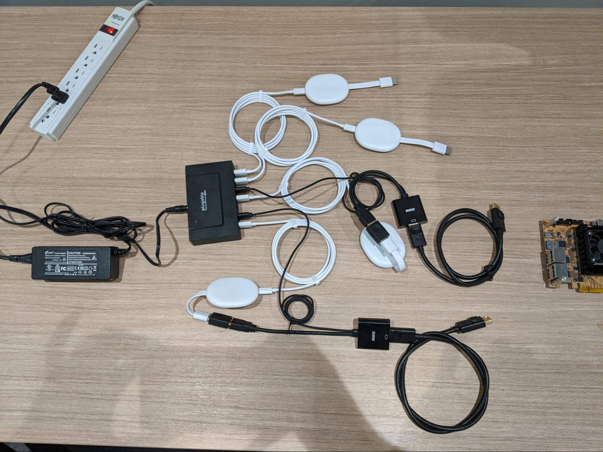
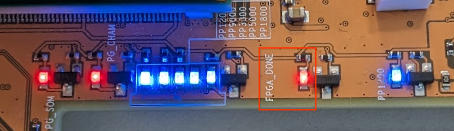
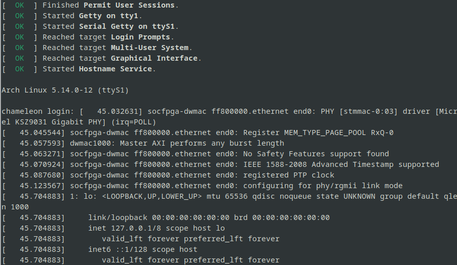
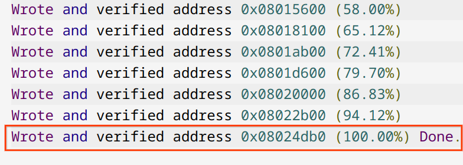
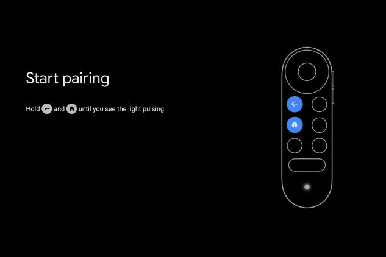

# Chameleon MP Factory Testing/QC
[TOC]

## Areas Covered
These are the things we want to make sure every board has working, meant to catch things like per-board soldering issues instead of the user realising their chameleon is half broken. It’s the “QC Pass” thing.

Note: This is not a design test, this is the set of tests that will be done on every board, so it needs to be quick.

1. All video input ports: DP1, DP2, HDMI1, HDMI2
2. ITE paths: DP1, DP2, HDMI1, HDMI2
3. EC Programming from the FPGA
4. FPGA<->EC Communications
5. SD Card
6. FPGA
7. Ethernet
8. Debugging USB connector

## Materials/Requirements
To be multiplied by as many chameleons you want to test in parallel.

1. Chameleons to test (also referred as DUT, Device Under Test)
2. Chameleon Power Supply
3. MicroSD card, 32GB, fast (will impact testing speed), good quality
4. SD card image for flashing
5. Workstation to send commands from:  
  a. Linux: debian or archlinux  
  b. **Not** a chromebook!  
  c. Root access, USB access  
  d. ssh client and server (in case remote support is needed)  
  e. python3 installed  
  f. GUI, so xdg-open picture_file.jpg will work
6. Ethernet access for chameleon to the same network the above workstation is on

## Chromecast Video Test Fixture
1. 4x [Chromecast 4K](https://store.google.com/product/chromecast_google_tv?hl=en-US) or [from Amazon](https://www.amazon.com/Google-Nest-GA01919-GA01919-US-Chromecast/dp/B08KRV7S22)
2. 2x [Cable Matters [VESA Certified] 3 ft DisplayPort Cable 1.4, Support 8K 60Hz, 4K 144Hz (DisplayPort 1.4 Cable) with FreeSync, G-SYNC and HDR for Gaming Monitor, PC, RTX 3080/3090, RX 6800/6900 and More](https://www.amazon.com/Cable-Matters-DisplayPort-Resolution-Support/dp/B079736SZL)
3. 2x [BENFEI HDMI to DisplayPort, HDMI to DisplayPort Adapter Compatible with Laptop, Xbox 360 One, PS4 PS3 HDMI Device](https://www.amazon.com/Active-DisplayPort-Adapter-Converter-Gold-Plated/dp/B0752D33PJ)
4. 1x [BENFEI HDMI Coupler, HDMI Female to Female Adapter for Extending HDMI Devices - 2 Pack](https://www.amazon.com/Coupler-Benfei-Adapter-Extending-Devices/dp/B07K6HKD8S)
5. 1x [Plugable USBC-HUB7BC](https://www.amazon.com/dp/B096YKDYX5)
6. 1x [USB type-A Male to USB type-C Male data cable](https://www.amazon.com/Cable-Matters-USB-IF-Certified-Black/dp/B06XMY49BM?th=1) (any replacements ok)

## Preparation Steps
1. Unpack the [chromecast video test fixture](#chromecast-video-test-fixture) components.
2. Set aside chromecast remotes and chromecast usb power supplies as they are not needed.
3. All chameleons and hdmi-adapters should be powered by the pluggable hub to simplify wiring
4. Pluggable hub upstream USB does not need to be plugged to a computer
5. Chromecasts do not need to be setup and configured. The first screen they
  emit should be sufficient for video tests ([Areas]: DP1 DP2 HDMI1 HDMI2).
6. Will look like an octopus, if you want you can tidy up some of the cables with cable ties 
  or some other method.
  
7. Download chameleon repo
    ```
    cd ~
    git clone https://chromium.googlesource.com/chromiumos/platform/chameleon
    curl "https://chromium.googlesource.com/chromiumos/overlays/chromiumos-overlay/+/main/chromeos-base/chromeos-ssh-testkeys/files/testing_rsa?format=TEXT"| base64 --decode > ~/chromeos_testing_rsa
    chmod 600 ~/chromeos_testing_rsa
    curl "https://chromium.googlesource.com/chromiumos/third_party/autotest/+/refs/heads/main/server/site_tests/display_EdidStress/test_data/edids/weekly/4K_ACER_CB240HK_HDMI.txt?format=TEXT"| base64 --decode > ~/chameleon_4k.edid.txt
    ```
8. Configure workstation’s ~/.ssh/config
    ```
    Match user cros,root
      IdentityFile ~/chromeos_testing_rsa
      UserKnownHostsFile /dev/null
      StrictHostKeyChecking no
    ```
9. Flash SD card with the image:  
  `dd if=chameleon_270_2.factory.img of=/dev/INSERT_SD_CARD_LOCATION_HERE bs=1M status=progress`
10. Power up pluggable HUB, wait about a minute for chromecasts to be fully on.
11. Plug USB type A side of the A to C cable into the workstation
12. Test it on a chameleon. PVT is fine and fully compatible.

## Testing Steps
1. Insert SD card into chameleon
2. Insert 12VDC power into chameleon barrel jack
3. Insert USB type C side of the A to C cable into the chameleon
4. Insert Ethernet into chameleon
5. Insert all video ports into chameleon
6. Power on chameleon
7. Terminal 1  
  a. type: `sudo /usr/bin/pyserial-miniterm --eol LF /dev/serial/by-id/usb-FTDI_Dual_RS232-HS-if01-port0 115200 --raw`  
  b. if it worked it should say:  
`--- Miniterm on /dev/serial/by-id/usb-FTDI_Dual_RS232-HS-if01-port0  115200,8,N,1 —`  
  c. If terminal 1 shows texts in 7b, mark step 7 as  pass  
  d. Repeat step 7a if it does not show texts in 7b, and mark step 7 as fail after 3 attempts  
`Chameleon login: `  
8. FPGA_DONE LED will turn on ~10s after power on  

9. Wait about 30 seconds after chameleon was first powered on  
  a. When you see something like this, it means it’s ready:  
  b. Press enter, and it should say chameleon login:  
  c. Proves [Areas]: Debugging USB Connector, SD Card, FPGA  
  d. If terminal 1 shows texts in 9b, mark step 9 as  pass   
  e. Turn off the power and repeat steps 6, 7, 8, and 9 if it does not show texts in 9b, and mark step 9 as fail after 3 attempts  
10. Terminal 2: SSH into chameleon  
  a. `ssh cros@192.168.20.220`  
      
  b. Proves [Areas]: Ethernet  
11. Terminal 2: Flash EC firmware  
  a. `sudo pacman -U boot_pkg/ec-firmware*pkg* --noconfirm`  
  b. Look for “Wrote and verified address 0x08024ea4 **(100.00%) Done.**”, this will be about 7 lines up from the last one  
      
  c. Proves [Areas]: EC Programming  
  d. If terminal 2 shows texts in 11b, mark step 11 as pass  
  e. Repeat step 11a if it does not show texts in 11b, and mark step 11 as fail after 3 attempts  
12. Terminal 2: Chameleond startup information  
  a. `journalctl --boot -e -u chameleond|grep 'board'`  
  b. Look for `'board': 4`, this proves BOARD_ID is set correctly for MP  
  c. `journalctl --boot -e -u chameleond|grep 'ec_ver'`  
  d. Look for `'ec_ver': 'v3-142-g914bc9f'`, should say the correct thing.  
  e. Proves [Areas]: EC Communication  
  f. If terminal 2 shows texts in 12b and 12d, mark step 12 as  pass  
  g. Repeat step 12a and 12c if it does not show texts in 12b and 12d, and mark step 12 as fail after 3 attempts  
13. Terminal 2: Check MAC address against label  
  a. `cros@chameleon:~$ ip addr|grep ether`  
    `link/ether 20:b0:f7:06:0d:cc brd ff:ff:ff:ff:ff:ff`  
  b. If terminal 2 shows MAC address that matches label, mark step 13 as  pass  
  c. If terminal 2 shows MAC address that does not matches label, mark step 13 as fail  
14. Terminal 3: Video port tests
    * Only needed at the start of the test session:  
      `cd ~/chameleon/v3/clients/`  
      `CHAMELEON_IP=192.168.20.220`  
    * For each of the ports:  
      | PORT_ID | Areas                      |
      |---------|----------------------------|
      | 0       | ITE Path + DP1 Connector   |
      | 1       | ITE Path + DP2 Connector   |
      | 2       | ITE Path + HDMI1 Connector |
      | 3       | ITE Path + HDMI2 Connector |
    * Run:
      * `./screenshot.py --host $CHAMELEON_IP --edid ~/chameleon_4k.edid.txt --open --port_id=0`
      * Check if `detected=True`
      * `Wait for input stable..` < this takes up to 30 seconds  
        * stable! is good  
        * Exception: Timeout while WaitVideoInputStable() is bad
      * Make sure resolution is 4k:
        ```
        Detected screen size 3840x2160
        Capturing the screen size 3840x2160...
        Got pixel size 24883200
        ```
      * Resolution not 3840x2160 means **fail**
      * See picture displayed on the screen, should look like all the other ones, Chromecast welcome screen? If garbled this is a fail. Black screen is suspect but chromecast might have gone to sleep?  
        
      * Repeat steps i, ii, iii, iv, and v for port_id=1
      * Repeat steps i, ii, iii, iv, and v for port_id=2
      * Repeat steps i, ii, iii, iv, and v for port_id=3
      * If any of the ports did not work, please swap cables from the ports that did into the ports that didn’t try again the failing port (in case the chromecast did not work).

15. Terminal 2:  
  `cros@chameleon:~$ [ $HOSTNAME == "chameleon" ] && sudo shutdown -h now || echo "Wrong terminal, use terminal 2"`

  * Wait a few seconds after ssh connection is closed before unplugging power. 
  * On Terminal 2 you should see something like
    ```
    Connection to 192.168.20.220 closed by remote host.
    Connection to 192.168.20 220 closed.
    ```
  * On Terminal 1 you should see something like:
    ```
    [   40.758053] systemd-shutdown[1]: Powering off.
    [   40.764835] reboot: System halted
    ```

16. Unplug video cables
17. Unplug chameleon from power
18. Unplug ethernet
19. Unplug SD card
  * Do not forget SD card inside the chameleon, really easy to do when packing them and then you have nothing to test the next chameleon with
20. Terminal 1:  
  Press enter or Ctrl+C to clear the `OSError: [Errno 5] Input/output error` so you can type commands for next chameleon

## Appendix
Linux operating system
  * Go to https://ubuntu.com/download/desktop.  Download Ubuntu 22.04.2 LTS.
  * Load the ubuntu-22.04.2-desktop-amd64.iso image
  * Install Ubuntu
  * `sudo apt-get install python3 git python3-serial openssh-server`
  * `sudo apt-get install imagemagick curl`
  * `sudo systemctl enable --now ssh`

[Areas]: #areas-covered