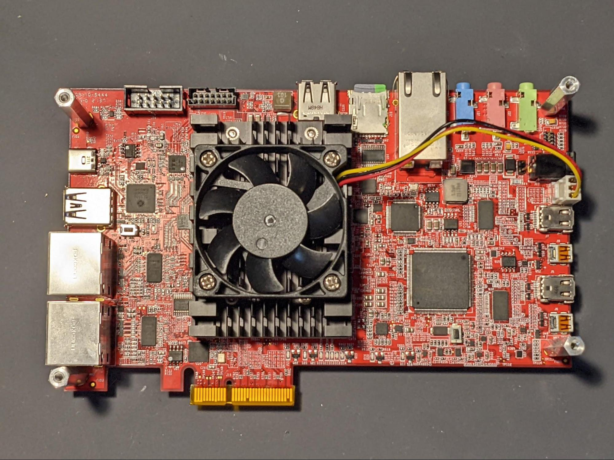
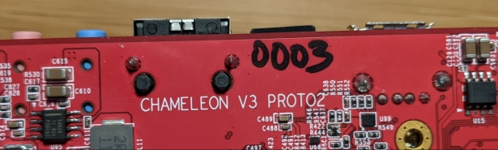
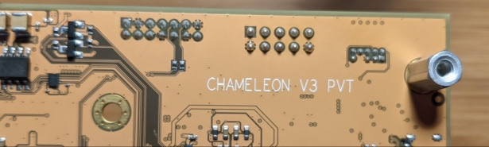
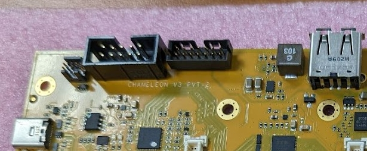

# Assembly

The chameleon you’ll receive will already be fully assembled and tested from the
factory. If you want to know more how it was done please see these documents:

* [Chameleon v3 MP assembly procedures](unboxing-factory-assembly.md)
* [Chameleon MP Factory Testing/QC](unboxing-factory-testing.md)

## Install the FPGA module

You’ll probably skip this if you have an MP chameleon.

**Power off the Chameleon v3 before installing the FPGA module.**

Line up the FPGA module's connectors with the connectors on the Chameleon v3.
Press down firmly and evenly.
Connect the fan power cable to the 3-pin connector near the power jack.

## How to tell what FPGA module you have

Look for a sticker on the heatsink or on the underside of the module, either
something about {270k, 480k} or a longer number starting with `EN`.

| Product number | Type    | Frequently found on | Chameleon/Uboot filenames |
| -------------- | ------- | ------------------- | ------------------------- |
| EN101917       | 480-2I3 | Proto 2             | 480_2                     |
| EN104218       | 480-2I3 | Proto 2             | 480_2                     |
| EN104216       | 270-3E4 | Proto 2 - late      | 270_3                     |
| EN104217       | 270-2I2 | PVT/MP              | 270_2                     |

## How to tell what chameleon version you have
**Proto 2(red)** vs
**PVT(yellow)** vs
**PVT-2/MP(yellow)**.

Board color is an obvious way, but there’s also the full name on the board.

All boards PVT and onwards are interchangeable, so if you have a
**yellow** board you’re good.

**MP boards are labeled as PVT-2:**

