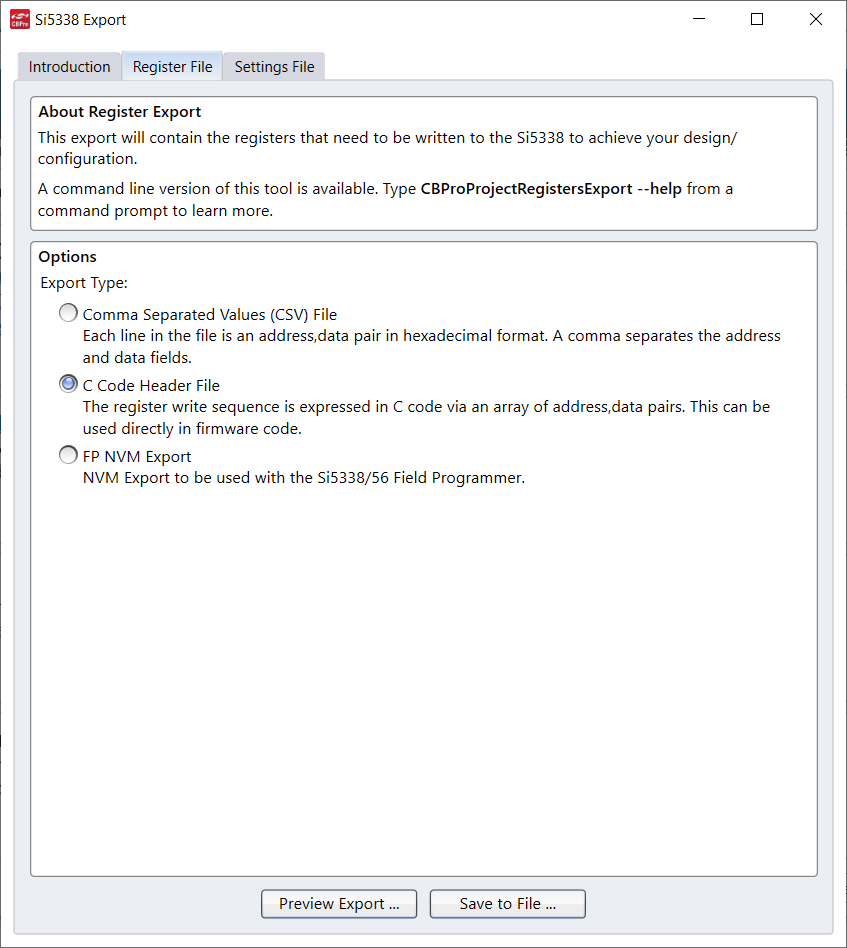
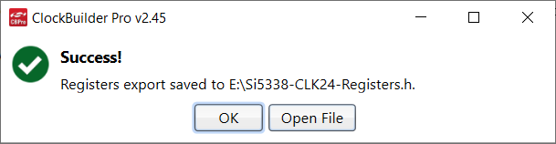

# Chameleon v3 Applications

Chameleon v3 has an embedded controller (an STM32H743ZI as of Proto 2) and
an FPGA with embedded ARM cores that run Linux.

This document describes how to build, install, and run the applications on
the Chameleon v3 hardware.

# Building the Chameleon Embedded Controller Application

This section describes how to build the Chameleon application for the
embedded controller.

## Installing Zephyr toolchain and source

Follow the instructions in the Zephyr [Getting Started Guide](https://docs.zephyrproject.org/latest/getting_started/index.html).

Ensure that you have sufficiently recent code

```
$ cd ~/zephyrproject
$ west update
$ cd zephyr/
$ git show 7b86137b6cca28c3d9c5f96b84a4408de198c8de
commit 7b86137b6cca28c3d9c5f96b84a4408de198c8de
Author: Yuval Peress <peress@google.com>
Date:   Thu Dec 9 20:43:36 2021 -0700

    fatal: fix missing extern "C"

    This was causing an error when building with pigweed as a module.

    Signed-off-by: Yuval Peress <peress@google.com>
```

If you do not see that commit in your tree, `git pull origin main` and then
check again.

## Installing Pigweed

If `ls ~/chromiumos/src/third_party/pigweed` comes up empty, sync your repo
to get the latest manifest and bring in the Pigweed repository.

You also need to `pip install pigweed` so that the Pigweed RPC tools are
installed.

## Building the application

```
cd ~/zephyrproject
west build -b chameleon -s ~/chromiumos/src/platform/chameleon/v3/ec
```

Output files are in `~/zephyrproject/build/zephyr`
* zephyr.bin
* zephyr.elf
* zephyr.hex

# Running the Chameleon Embedded Controller Application

This section describes how to build and use the Chameleon application on
the Chameleon v3 Proto 2 hardware (with an STM32H743ZI embedded controller).

## Programming the board

The H743 bootloader supports multiple interfaces including USART and USB-DFU.

Because of how the USB is connected, the H743 bootloader will always use
USB-DFU if the USB-C port is connected to a host PC. The USART is only
available if the USB-C port is disconnected and the AP is using USART2 to
update the H743.

### Jlink

Connect a [SEGGER JLink](https://www.segger.com/products/debug-probes/j-link/)
to the JTAG connector using a
[9-pin Cortex-M adapter](https://www.segger.com/products/debug-probes/j-link/accessories/adapters/9-pin-cortex-m-adapter/)

Connect 12V power to the Chameleon.

```
cd ~/zephyrproject
west flash --erase --reset-after-load
```

### USB-DFU

Install `dfu-util` on your system with `apt-get install` or similar.

1. Press and hold the RESET button on the top side of the PCB
1. Press and hold the BOOT0 button on the bottom side of the PCB
1. Release the RESET button on the top side
1. Release the BOOT0 button on the bottom side
1. Run `dfu-util -a 0 -s 0x08000000:leave -D ~/zephyrproject/build/zephyr/zephyr.bin`

### stm32flash

`stm32flash` v 0.6 added support for the H743. You may need to build it from
source and install it on your system. The following commands will
reset the the EC into bootloader moder and use `stm32flash` to reprogram the
EC.

```
modprobe i2c-dev
sudo i2cset -y 1 0x21 0x06 0x3f
sudo i2cset -y 1 0x21 0x02 0xbf
sudo i2cset -y 1 0x21 0x02 0xff
sudo stm32flash -w ~/zephyrproject/build/zephyr/zephyr.bin -v -S 0x8000000 -f /dev/ttyS0
```

## Running the application

When the Zephyr kernel boots, the POWER_GOOD LED (red LED near the PCIe
connector) turns on and stays lit. The shell prompt (`$`) appears after the
startup messages:

```
*** Booting Zephyr OS build v2.7.0-rc3-2411-gf8cd20fa3e74  ***

$
```

There may also be some log messages from modules starting up.

## POWERGOOD LED

`io set POWER_GOOD off` and `io set POWER_GOOD on` control the POWERGOOD LED.

## Micro SD Card

The micro SD card can be connected to the PC through the same USB connection
as the serial console, connected to the FPGA's SD card controller, or
completely disconnected. The `sd` commands takes a sub-command:
* `off` - Disconnect the SD card from the USB port and the FPGA
* `usb` - Connect the SD card to the USB port
* `fpga` - Connect the SD card to the FPGA's SD card controller
* `status` - Show the current setting for the SD mux and the status of the
  CD_DET line.

Start with the uSD slot empty.
```
uart:~$ sd status
The SD mux is set to disconnected
CD_DET = 1
```
Push the card into the slot.
```
uart:~$ sd status
The SD mux is set to disconnected
CD_DET = 0
```
Physically eject the card.

Connect the mux to the USB controller.
```
uart:~$ sd usb
```
Push the card into the slot.
```
uart:~$ sd status
The SD mux is set to USB
CD_DET = 0
```
Your computer will show a new removable drive for the uSD card.

Use the operating system to "safely eject" the removable drive.

Physically eject the card.

Connect the mux to the FPGA.
```
uart:~$ sd fpga
```
Push the card into the slot.
```
uart:~$ sd status
The SD mux is set to FPGA
CD_DET = 0
```
Your computer will not show a new removable drive for the uSD card.
```
uart:~$ sd off
```
Physically eject the card.

## System Monitor

The System Monitor reads several different voltages on the Chameleon and
can provide a human-readable summary of the various voltages and the current
monitors.

The command `sysmon` prints a list of the various voltages being monitored:

```
$ sysmon
12V: 12.645703
CMON_SOM: 0.279565
CMON_BOARD: 0.149854
PP1200: 1.242334
CMON_PP1200: 0.157104
CMON_PP3300: 0.388330
VMON_9V: 9.464941
VMON_5V: 5.011230
VMON_3V3: 3.313696
PP1800: 1.956958
SOM_VMON: 0.913623
SOM_VMON_1V2: 1.199634
SOM_VMON_MGT: 1.048975
SOM_VMON_1V8A: 1.812744
SOM_VMON_C8: 0.001611
VREF_CS1: 0.000806
VREF_CS2: 0.000000
VREF_CS3: 0.000806
```

The SOM_VMON voltages will not be accurate unless the FPGA SOM is installed
and its power supplies are enabled. In this example, the FPGA SOM is not
installed.

Because of the use of a timer to drive the sampling sequence, you can get
zero values if you run the `sysmon` command soon after start-up. Within a
few seconds, all of the values are populated.
```
$ sysmon
12V: 12.648926
CMON_SOM: 0.318237
CMON_BOARD: 0.152271
PP1200: 1.219775
CMON_PP1200: 0.323071
CMON_PP3300: 0.385107
VMON_9V: 9.381152
VMON_5V: 5.001563
VMON_3V3: 3.307654
PP1800: 1.922314
SOM_VMON: 0.912012
SOM_VMON_1V2: 1.203662
SOM_VMON_MGT: 1.052197
SOM_VMON_1V8A: 0.000000
SOM_VMON_C8: 0.000000
VREF_CS1: 0.000000
VREF_CS2: 0.000000
VREF_CS3: 0.000000
$ sysmon
12V: 12.687597
CMON_SOM: 0.286816
CMON_BOARD: 0.206250
PP1200: 1.207690
CMON_PP1200: 0.646143
CMON_PP3300: 0.385107
VMON_9V: 9.381152
VMON_5V: 5.001563
VMON_3V3: 3.307654
PP1800: 1.922314
SOM_VMON: 0.912012
SOM_VMON_1V2: 1.203662
SOM_VMON_MGT: 1.052197
SOM_VMON_1V8A: 1.812744
SOM_VMON_C8: 0.004028
VREF_CS1: 0.000000
VREF_CS2: 0.002417
VREF_CS3: 0.003223
```

## Clock Generator

The Si5338 clock generator chip provides a 100 MHz clock to the FPGA SOM.
There is no API for this; the initialization is done at startup using a
`SYS_INIT` function.

The Si5338 is fairly complex, and configuration is best done with Silicon
Labs' [Clock Builder Pro software](https://www.silabs.com/products/development-tools/software/clockbuilder-pro-software).
This is an MS Windows-only tool, so I ran it on my personal laptop, saved
the project (it uses a binary format) and exported a C header file with all
of the register settings.

* Run the Clock Generator tool
* Import the settings file and make any changes
* Choose "Export"
* Switch to the "Register File" tab



Use the file name that the program suggests, `Si5338-CLK24-Registers.h`.



* Copy the file to your Linux system
* Convert the file to UNIX-style line endings, `dos2unix Si5338-CLK24-Registers.h`
* Modify the header file so that it will build with C++:

* Add
```
#ifdef __cplusplus
extern "C" {
#endif
```
just before the `#define NUM_REGS_MAX`.

* Add
```
#ifdef __cplusplus
}
#endif
```
at the end of the file.

* Change register 6 from `{  6,0x08,0x1D},` to `{  6,0x00,0x1D},`. There doesn't
appear to be a direct way to do this in the Clock Generator tool.

Note `checkpatch.pl` will flag almost every line of the generated file;
ignore the errors and continue.

The clock output can be verified with an oscilloscope and either a very steady
hand or some short wires to attach probes. When the board is in reset, the
clock output is idle, but as soon as the `SYS_INIT` function runs, the clock
output changes to a 100 MHz signal.

## FPGA power/boot sequence

The STM32 controls the power enable and power-on-reset for the FPGA, and
monitors the signals for power good and configuration done. With an FPGA
module installed, the FPGA module power good LED (D21,
just to the right and above the PCIe connector) will briefly turn on and
then off again as the STM32 asserts control over the signal.
[Chameleon FPGA Power/Boot Sequence State Machine](./fpgaboot_sm.md)
provides details of the state machine.

The shell provides the `fpga` command, which has three subcommands:
* `on` to start the power-on and boot sequence for the FPGA module
* `off` to turn off the FPGA module immediately
* `status` to report status
* `bootmode` to set the bootmode to `emmc`, `qspi`, or `sdio`

A new FPGA module will not have a bitstream on it, so a failure to reach
the power-on state is expected behavior.

* Remove power from the Chameleon v3
* Install the FPGA module
* Apply power
* Open the serial console
* Set the boot mode and query the status
```
$ fpga bootmode qspi
FPGA boot mode set to qspi
$ fpga status
FPGA steady status: true
BOOT_MODE = 01
PWR_EN = 0
PWR_GOOD = 0
POR_L_LOAD_L = 0
FPGA_DONE = 0
```
* Start the power-on and boot sequence
```
$ fpga on
FPGA power on ...
```
* The PWR_GOOD LED (leftmost, closest to the PCIe connector) will turn on.
* Set the boot mode. It should fail
```
$ fpga bootmode emmc
FPGA is busy. Try again in a few seconds.
$ fpga status
FPGA steady status: false
BOOT_MODE = 01
PWR_EN = 1
PWR_GOOD = 1
POR_L_LOAD_L = 1
FPGA_DONE = 0
```
* After 10 seconds, the PWR_GOOD LED will turn off; the state machine didn't see
FPGA_DONE assert (because there is no bitstream on the FPGA), so it turned off
power.
* Query the status again
```
$ fpga status
FPGA steady status: true
BOOT_MODE = 01
PWR_EN = 0
PWR_GOOD = 0
POR_L_LOAD_L = 0
FPGA_DONE = 0
$
```

## I/O expanders

The Chameleon v3 has three 16-bit I/O expanders on I2C2. The signals connected
to these I/O expanders are one-time configuration signals, operational mode
and reset signals that are changed very infrequently, or fixed signals for
board identification.

The `misc_io` module exposes an API to read the three BOARD_VERSION signals
as an integer. It also provides debugging commands in the shell to read the
BOARD_VERSION signals, and to read and write two debug signals that are
connected to TP125 and TP126.

After programming the latest firmware, experiment with these commands in the
shell:

```
$ board
BOARD_VERSION[2:0] = 2
$ io get TP125
TP125 = 0
$ io get TP126
TP126 = 0
$ io set TP125 on
$ io get TP125
TP125 = 1
$ io set TP126 on
$ io get TP126
TP126 = 1
$ io set TP125 off
$ io get TP125
TP125 = 0
$ io set TP126 off
$ io get TP126
TP126 = 0
```

If you hook up a logic analyzer to I2C2 SCL and SDA, TP125, and TP126, you can
see the I2C bus transactions between the STM32 and U78 (which has device
address 0x21) to read and write the individual bits, as well as watching TP125
and TP126 change when they are written.

## I2C bus switch

The Chameleon v3 has a MAX7367 I2C bus switch on I2C1. On the other side of
the switch, buses 0 and 1 have a PS8468 DP demux, PS8469 video output demux,
and MCDP2900 DP to HDMI translator. These are on separate buses due to device
address conflicts. Bus 2 has two EP91A6SQ HDMI repeaters with different device
addresses set by pin strapping. Bus 3 has no connections. There is a single
interrupt line from the MAX7367 that can be asserted by any of 4 interrupt
lines on the other side of the switch. Only IRQ2 is actually connected to
an interrupt source (the EP91A6SQ chips).

The `i2c_switch` module exposes a simple API to control the reset line to the
MAX7367 (to recover in case of a bus hang), to control the bus switching, and
to read the interrupt line status. There is also a binary semaphore that the
IRQ handler gives, although there is currently no task that waits on the
semaphore.

The `i2c_switch` shell command allows setting the switch value. Provide a value
from 0 to 3 to select one of the buses, or a value outside that range to turn
off all buses. The effect of the switch can be seen with `i2c scan I2C_1` (as
provided by Zephyr's `i2c_shell.c`).

```
$ i2c_switch 2
$ i2c scan I2C_1
     0  1  2  3  4  5  6  7  8  9  a  b  c  d  e  f
00:             -- -- -- -- -- -- -- -- -- -- -- --
10: -- -- -- -- -- -- -- -- -- -- -- -- -- -- -- --
20: -- -- -- -- -- -- -- -- -- -- -- -- -- -- -- --
30: -- -- -- -- -- -- -- -- -- -- -- -- -- -- -- --
40: -- -- -- -- -- -- -- -- -- -- -- -- -- -- -- --
50: -- -- -- -- -- -- -- -- -- -- -- -- -- -- -- --
60: -- -- -- -- 64 65 -- -- -- -- -- -- 6c 6d -- --
70: -- -- -- 73 -- -- -- --
5 devices found on I2C_1
$ i2c_switch 3
$ i2c scan I2C_1
     0  1  2  3  4  5  6  7  8  9  a  b  c  d  e  f
00:             -- -- -- -- -- -- -- -- -- -- -- --
10: -- -- -- -- -- -- -- -- -- -- -- -- -- -- -- --
20: -- -- -- -- -- -- -- -- -- -- -- -- -- -- -- --
30: -- -- -- -- -- -- -- -- -- -- -- -- -- -- -- --
40: -- -- -- -- -- -- -- -- -- -- -- -- -- -- -- --
50: -- -- -- -- -- -- -- -- -- -- -- -- -- -- -- --
60: -- -- -- -- -- -- -- -- -- -- -- -- -- -- -- --
70: -- -- -- 73 -- -- -- --
1 devices found on I2C_1
```

## Video Mux Routing

[Video Mux Routing](./videomux.md) describes how the video signals are routed
to either the HDMI Receiver IC or to the FPGA, plus how to test the EDID portion
of the video path even without an FPGA module.

# Running the Chameleon Linux Application

## Setup

Follow the instructions in the [Chameleon v3 AP Care & Feeding](https://drive.google.com/drive/folders/1tz97RrCWTage-dET76VyppT8xzyukjrK?resourcekey=0-s29tyylG2C0gXg35TtYBOg&usp=sharing)
documentation to set up the micro SD card for the Linux system.

After the Linux system boots, log in and run the following commands:

```
sudo pacman -Syy
sudo pacman -Syu
sudo pacman -S python-pip
sudo pip install pigweed
sudo pacman -S protobuf
```

Copy the v3 proto to `~alarm`.

## Experimenting with RPC

Start the RPC console by running
```
sudo python -m pw_hdlc.rpc_console -o /tmp/pw_hdlc.log -d /dev/ttyS0 --proto-globs v3.proto
```

Once the console starts, experiment with RPC calls, e.g.
```
client.rpcs()["board_service"].get_hpd()
```

Alternatively, http://crrev.com/c/3413534 provides a simple REPL and some
syntactic shortcuts.

### board_service RPC

The following console output (with line breaks added for readability)
demonstrates two RPC calls to the `board_service` and typical results.

```
[alarm@alarm ~]$ python -i connect.py
board_service = Service('board_service',
     methods=['get_board_version', 'get_sysmon', 'get_hpd'], channel=1)
videomux_service = Service('videomux_service',
     methods=['get', 'set', 'all_off'], channel=1)
it68051_service = Service('it68051_service',
     methods=['select_port', 'set_hpd', 'set_edid_idx', 'write_edid'],
     channel=1)
>>> board_service.get_board_version()
(Status.OK, board_service_version_response(version=2))
>>> board_service.get_sysmon()
(Status.OK, sysmon_response(
vmon_12v=12.587695121765137,
cmon_som=0.620361328125,
cmon_board=0.11279296875,
vmon_1v2=1.238305687904358,
cmon_pp1200=0.1611328125,
cmon_pp3300=0.3689941465854645,
vmon_9v=9.500391006469727,
vmon_5v=4.985449314117432,
vmon_3v3=3.3100709915161133,
vmon_1v8=1.919091820716858,
som_vmon=0.913623034954071,
som_vmon_1v2=1.194799780845642,
som_vmon_mgt=1.041723608970642,
som_vmon_1v8a=1.8046875,
som_vmon_c8=0.0008056640508584678,
vref_cs2=0.0008056640508584678))
```

### videomux_service RPC

Connect a Chromebook to the Chameleon DisplayPort 2 input with a USB-C
DisplayPort adapter. Open the Settigns app, select Device, then Displays.

On the EC console enable the DisplayPort 2 input.
```
$ videomux dp2 rx
Connect DP2 to receiver
```

The Chromebook will recognize a second display.

In the REPL, use the `videomux_service` to query the mux state and then
disconnect all video inputs.
```
>>> r=videomux_service.get()
>>> r.response.dp2
2
>>> videomux_service.all_off()
(Status.OK, Empty())
```

The second display will no longer be available on the Chromebook.

Now connect the DisplayPort 2 input to the HDMI receiver again, but using
an RPC instead of an EC console command:
```
>>> videomux_service.set(hdmi1=0,hdmi2=0,dp1=0,dp2=2)
(Status.OK, videomux_service_set_response(result=True))
```

The Chromebook will recognize a second display. Verify the connection on the
EC console:
```
$ videomux get
DP1: n/c
DP2: HDMI RX
HDMI1: n/c
HDMI2: n/c
```

### it68051_service RPC

Connect a Chromebook to the Chameleon DisplayPort 2 input with a USB-C
DisplayPort adapter. Open the Settigns app, select Device, then Displays.

In the REPL, use the `videomux_service` to enable tje Display Port 2 input.
```
videomux_service.set(hdmi1=0,hdmi2=0,dp1=0,dp2=2)
```

The Chromebook will recognize a second display with the name "ITE6802".

Turn off the display, select a different EDID, and turn the display back
on by
```
it68051_service.set_hpd(port=0,on_off=0)
it68051_service.set_edid_idx(edid_idx=17)
it68051_service.set_hpd(port=0,on_off=1)
```

The second display is now named "CB240HYK".

**Note** unlike `cmd_edid` in `it68051_shell.c`, there is no provision for
saving the state of HPD for both ports, adding a delay if either HPD was
asserted, or restoring the state of HPD after the new EDID has been selected
and initialized.

To write a raw EDID, grab one from
`third_party/autotest/files/server/site_tests/display_EdidStress/test_data/edids`,
such as `weekly/4K_ASUS_PB287Q_HDMI.txt`. Copy it to the SD card in the same
place as `connect.py`

Run `sudo python3 -i connect.py`

```
>>> f = open('4K_ASUS_PB287Q_HDMI.txt', 'r')
>>> lines = f.readlines()
>>> f.close()
>>> one_line = ''.join([line.rstrip('\n') for line in lines])
>>> PB287Q = bytes.fromhex(one_line)
```

If you `print('PB287Q')`, you will see it is a byte string starting with
`b'\x00\xff\xff\xff\xff\xff\xff\x00\x04\x69\xa3\x28`

Now send the EDID to the EC
```
>>> it68051_service.write_edid(raw_edid=PB287Q)
```

With a Chromebook connected to HDMI2, turn on the HDMI2 port
```
$ videomux hdmi2 rx
```

The Chromebook shows that an ASUS PB287Q monitor is connected.

# Unit Tests

[Chameleon Unit Tests](./unittest.md) describes how to build and run unit
tests for code modules that do not rely on hardware.
