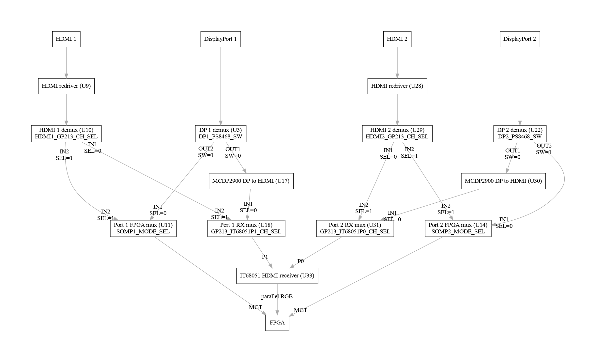
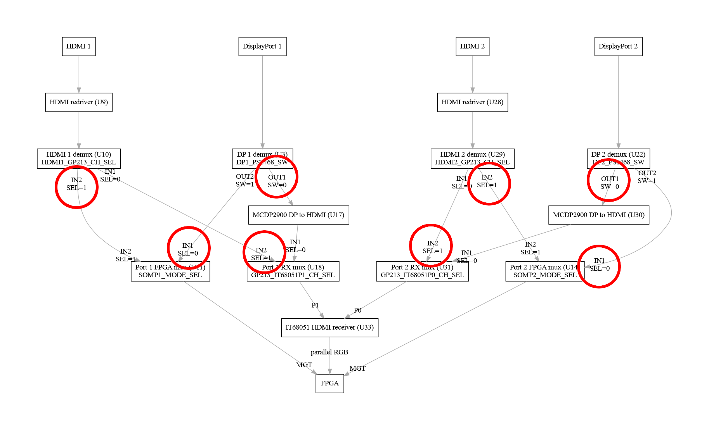
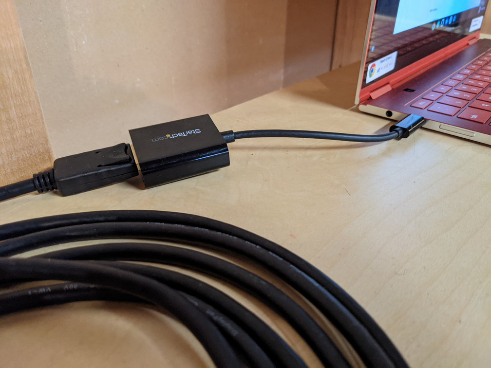
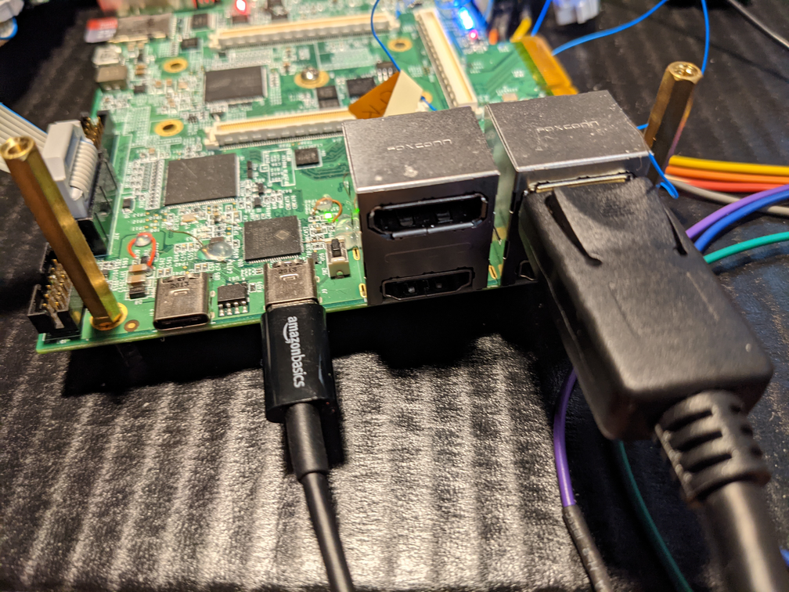
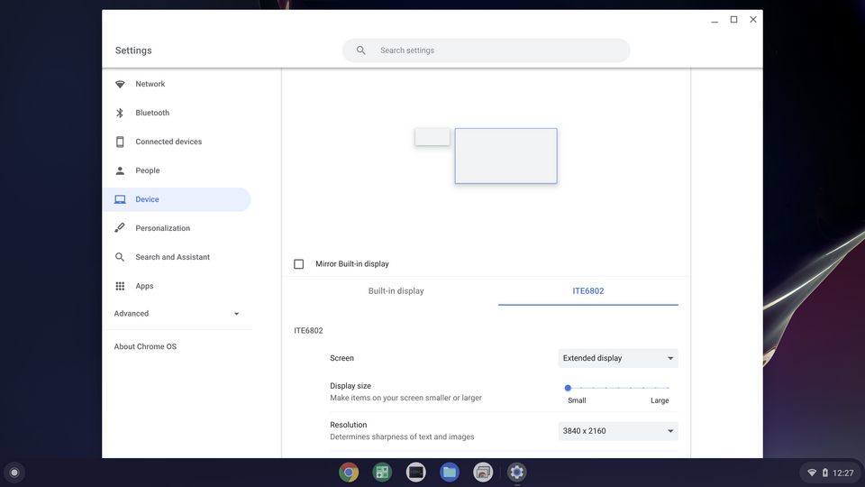

# Video Mux Routing

The Chameleon v3 has two HDMI and two DisplayPort connectors. The video
signals for each of these connectors can be routed through a sequence of
demuxes and muxes to connect the port to the FPGA's Multi-Gigabit Transceivers
(MGTs) or to an IT68051 HDMI receiver. Note that the DisplayPort signals pass
through an MCDP2900 DisplayPort to HDMI converter if they are being routed to
the IT68051 HDMI receiver.

The signal routing from connector to FPGA and HDMI receiver can be seen
in this diagram. The control signals for the demuxes and muxes are shown
by each demux/mux.



Note that the ports are numbered externally as ports 1 and 2 (with HDMI1 and
DP1 being closest to the USB-C connectors), but that the routing to the
IT68051 receiver is HDMI1/DP1 to port **1**, while HDMI2/DP2 are routed to
port **0**.

The table below shows the routing for DP1 and DP2, with the reference
designators for the muxes and demuxes shown in the same order.
For example, to route DP1 to the IT68051, set the select line on U3 (which is
`DP1_PS8468_SW`) to 0, set the select line on U18 (which is
`GP213_IT68051P1_CH_SEL`) to 0, and don't bother with the select line on U11.

```
U3/U22      U18/U31     U11/U14     DP1/DP2 connection
------      -------     -------     ------------------
0           0           x           IT68051
1           x           0           FPGA
```

This table shows the routing for HDMI1 and HDMI2, with the reference
designators for the demuxes and muxes shown in the same order.
For example, to route HDMI2 to the FPGA, set the select line on U29 (which
is `HDMI2_GP213_CH_SEL`) to 1, don't bother with U31, and set the select line
on U14 (which is `SOMP2_MODE_SEL`) to 1.

```
U10/U29     U18/U31     U11/U14     HDMI1/HDMI2 connection
------      -------     -------     ----------------------
0           1           x           IT68051
1           x           1           FPGA
```

Note that U3 and U22 play no part in the HDMI signal routing, while U10 and U29
play no part in the DisplayPort signal routing.

Only one of HDMI1 and DP1 can be connected to the FPGA. The other can be
connected to the IT68051, or it can be left unconnected. The same restriction
applies to HDMI2 and DP2.

## Shell Commands

The `videomux` shell command offers a way to read and set the state of the
muxes and demuxes. `videomux get` will read the select signals for all 8
of the chips that involved in demuxing and muxing the signals and report
them as raw 0 and 1. It will then interpret those signals to show the routing
for the DisplayPort and HDMI connections to the HDMI receiver and the
FPGA MGTs:
```
$ videomux get
U3:0 U10:1 U11:1 U18:0 U22:0 U29:1 U31:0 U14:1
DP1: HDMI RX
DP2: HDMI RX
HDMI1: FPGA
HDMI2: FPGA
```

To set the muxes and demuxes, use the `videomux` command, specify the port
as `dp1`, `dp2`, `hdmi1`, or `hdmi2`, and the destination of `fpga` or `rx`
(the IT68051  HDMI receiver). So, for example:
```
$ videomux dp1 fpga
Connect DP1 to FPGA
$ videomux get
U3:1 U10:1 U11:0 U18:0 U22:0 U29:1 U31:0 U14:1
DP1: FPGA
DP2: HDMI RX
HDMI1: n/c
HDMI2: FPGA
```

## Disabling all video inputs

To disable all video inputs, use `videomux off`. This command configures the
muxes so that the inputs are not connected to either the FPGA or the HDMI
receiver. The demux and mux control signals are set so that the demux's
**active** output is connected to the **inactive** input on the mux.

For example, the DisplayPort1 demux (U3) is selected to route the signal into
the MCDP2900 protocol converter, but the HDMI receiver mux (U18) is set to
its other input, so the converted HDMI stream from DisplayPort1 is never
connected to the HDMI Receiver.

Borrowing
the tables from earlier, the demuxes and muxes are configured as follows:

```
U3/U22      U10/U29     U18/U31     U11/U14     DP1/DP2 connection  HDMI1/HDMI2 connection
------      ------      -------     -------     ------------------  ----------------------
0           1           1           0           n/c                 n/c
```

Or, for a visual representation, refer to the diagram showing the selections
on each demux and mux.



## DisplayPort to IT68051

The Proto 0 board can connect either DisplayPort connector to the IT68051
HDMI receiver IC. By default, DP2 is enabled.

Connect a USB-C DisplayPort adapter to a Chromebook



Connect the DisplayPort cable to DP2 (furthest from the USB-C connectors)



The Chromebook will recognizes an external display named "ITE6802" with
various resolutions available up to 4K.



To switch to the other DisplayPort, type the following commands in the
EC shell:
```
videomux dp1 rx
it68051 select 1
it68051 hpd 1 1
```

To switch back to DisplayPort 2, type the following commands:
```
videomux dp2 rx
it68051 select 0
it68051 hpd 0 1
```
**Note**: The IT68051 numbers its ports 0 and 1, while the DisplayPort
connectors are numbered 1 and 2. DP1 connects to the IT68051's port 1, and
DP2 connects to the IT68051's port **0**.

To hold the IT68051 in reset (disabling the external display),
```
io set IT68051_RST_L 0
```

To release reset and re-initialize the IT68051,
```
io set IT68051_RST_L 1
it68051 init
```
